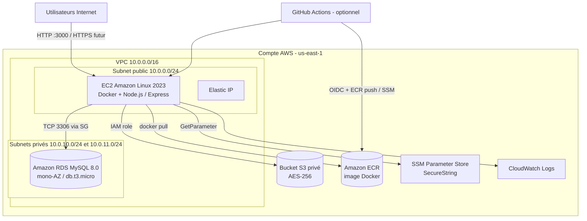

# Architecture technique — My Music

## Architecture V1

## Composants conformes au dossier

| Couche | Choix V1 |
|---|---|
| Calcul | Une EC2 `t3.micro` dans le subnet public, avec Elastic IP |
| Application | Node.js / Express, port 3000, image Docker |
| Reverse proxy / TLS | Nginx + Certbot prévus dans la description d'architecture, non inclus dans le chemin de test final à port 3000 |
| Base | RDS MySQL 8.0, `db.t3.micro`, stockage 20 Go, mono-AZ, non publique |
| Réseau | VPC `/16`, un subnet public, deux subnets privés RDS ; pas de NAT Gateway |
| Fichiers | Bucket S3 privé, blocage accès public et chiffrement AES-256 |
| Registre | ECR privé `my-music` |
| Secrets | SSM Parameter Store `SecureString` |
| Administration | Systems Manager Session Manager, rôle IAM attaché à EC2 |
| CI/CD | GitHub Actions (workflow proposé dans ce dépôt) |

## Choix de sécurité

- La base n'est pas accessible publiquement et le Security Group RDS n'autorise le port 3306 que depuis le Security Group EC2.
- Le bucket S3 bloque tout accès public. L'application génère des URL pré-signées courtes pour l'écoute des fichiers.
- L'instance EC2 utilise un rôle IAM ; aucune clé AWS permanente n'est configurée dans le conteneur ou sur EC2. Le hop limit IMDSv2 est réglé à 2 pour que le conteneur Docker puisse accéder aux credentials du rôle attaché à EC2.
- Le mot de passe RDS et le secret JWT sont stockés dans SSM Parameter Store en `SecureString`.
- Le port SSH 22 est limité au CIDR `my_ip`. L'accès via SSM reste privilégié.

## Écarts explicités

Le rapport présente une V1 minimaliste, mais la capture de test final expose directement le port 3000 en HTTP. Nginx/Certbot, la supervision complète et la haute disponibilité sont annoncés comme évolutions ou choix à finaliser. Cette reconstruction n'ajoute ni ALB, ni NAT Gateway, ni Auto Scaling Group.
